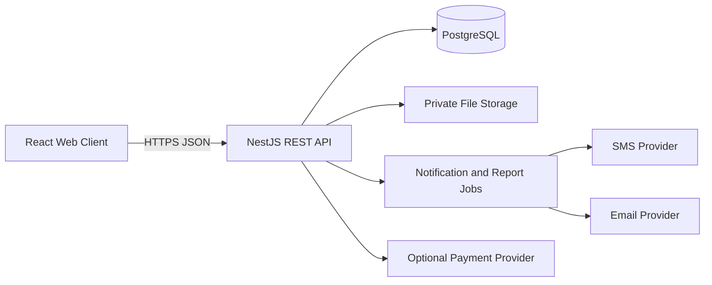

# Software Design Document (SDD)

## Ethiopian High School Management Information System

**Project:** School Management System  
**Related specification:** `srs.md` Version 1.0  
**Document version:** 1.0  
**Status:** Implementation design baseline  
**Architecture:** Modular monolith  
**Backend:** NestJS 10, TypeScript, Prisma  
**Frontend:** React 19, TypeScript, Vite, Tailwind CSS, shadcn/ui  
**Database:** PostgreSQL  
**API:** REST under `/api`

---

## 1. Purpose and design goals

This document translates the requirements in `srs.md` into a concrete technical design for a single-school Grades 9-12 management information system.

The design goals are:

1. Keep academic, student, financial and communication data in one consistent system.
2. Enforce role and relationship-based authorization in the backend.
3. Preserve historical academic and financial records.
4. Support configurable Ethiopian school policies instead of hardcoding grading or promotion rules.
5. Provide responsive green-themed portals for administrators, teachers, students and parents.
6. Keep the initial deployment simple through a modular monolith.
7. Make future modules such as library, HR, counseling and inventory additive rather than disruptive.

The current repository already contains working modules for authentication, users, academic data, attendance, grades, finance, communication, reports and search. This SDD defines the target architecture and identifies extension points for the remaining SRS capabilities.

---

## 2. Design principles

### 2.1 Backend is the source of truth

The frontend must never connect directly to PostgreSQL. All reads and writes go through authenticated backend APIs. UI visibility is not an authorization mechanism.

### 2.2 Explicit business workflows

Important operations are modeled as state transitions rather than unrestricted CRUD:

- Admission approval.
- Enrollment activation.
- Attendance session opening and closing.
- Marks draft, submission, review and approval.
- Result approval and publication.
- Invoice and payment lifecycle.
- Promotion approval.
- Academic-year closure.

### 2.3 Historical data is immutable by default

Approved results, confirmed payments, closed academic periods, audit records and historical enrollments must not be silently overwritten or deleted. Corrections use controlled workflows that create a traceable history.

### 2.4 Configuration over assumptions

Academic-year dates, semesters, grading scales, assessment weights, promotion rules, fees, currency, languages and notification behavior are stored as configuration. Every approved result stores the policy version used to calculate it.

### 2.5 Least privilege

Authorization is based on:

- Role.
- Permission.
- Record ownership.
- Assigned class, subject or department.
- Verified parent-child relationship.
- Academic period.

### 2.6 Consistent API and UI behavior

All modules use consistent validation, response envelopes, pagination, loading states, error states, audit behavior and notification patterns.

---

## 3. System context



### 3.1 External actors

| Actor | Interaction |
|---|---|
| School administrator | Configures users, roles, school and system settings |
| Principal | Reviews dashboards, approvals, oversight and reports |
| Academic director | Configures academic operations and reviews results |
| Registrar | Manages admissions, students, guardians and enrollment |
| Teacher | Manages assigned attendance, assignments and marks |
| Accountant/cashier | Configures fees, invoices, payments and receipts |
| Student | Views personal academic information |
| Parent/guardian | Views only verified linked children |
| Notification provider | Sends optional SMS or email notifications |
| Backup operator | Performs and verifies database recovery procedures |

### 3.2 Deployment boundary

The initial system is a single-school installation. It has one PostgreSQL database and one logical school context. The schema retains `schoolId` on school-owned records where appropriate so that future multi-school separation is possible without changing every domain model.

---

## 4. High-level architecture

The backend is a modular monolith. Each module owns its application logic and exposes services to other modules through explicit methods. Modules share Prisma through `PrismaModule`, but controllers must not contain database business logic.

```text
Browser
  |
  v
React application
  |-- authentication context
  |-- route guards
  |-- TanStack Query server state
  |-- API service layer
  |-- reusable UI components
  |
  v
NestJS application
  |-- global configuration
  |-- global JWT guard
  |-- global role guard
  |-- validation pipe
  |-- exception filter
  |-- audit interceptor
  |-- feature modules
  |
  v
Prisma ORM
  |
  v
PostgreSQL
```

### 4.1 Layers

#### Presentation/API layer

Responsibilities:

- HTTP routes.
- Authentication and authorization decorators.
- DTO validation.
- Swagger metadata.
- Pagination and query parsing.
- Response status codes.

Controllers must delegate business decisions to services.

#### Application/service layer

Responsibilities:

- Business workflows.
- Permission-scope checks that require database context.
- Transaction boundaries.
- State transitions.
- Cross-module coordination.
- Audit event creation.

#### Persistence layer

Responsibilities:

- Prisma queries.
- Transactions.
- Relations and includes.
- Database-specific constraints.
- Pagination and indexes.

The repository currently uses Prisma services directly in feature services. Repository classes may be introduced when a module's query complexity requires them; this is not required for simple CRUD.

#### Integration layer

Responsibilities:

- Email and SMS delivery.
- Payment gateway adapters.
- File storage.
- PDF generation.
- Backup status and health checks.

External integrations must be replaceable through interfaces and adapters.

---

## 5. Backend module design

### 5.1 Current and target modules

| Module | Responsibility | Current status |
|---|---|---|
| `auth` | Login, refresh, logout, password reset and profile | Implemented |
| `users` | User profiles, role-specific records, parent linking and activity | Implemented |
| `academic` | Schools, years, grades, classes, subjects and timetable data | Implemented in consolidated form |
| `attendance` | Sessions, records, corrections and attendance reports | Implemented |
| `grades` | Assessment types, assessments, marks and grade records | Implemented |
| `finance` | Fees, invoices, payments and finance operations | Implemented |
| `communication` | Messages, announcements and notifications | Implemented |
| `reports` | Dashboards, analytics and exports | Implemented |
| `search` | Authenticated global search | Implemented |
| `audit` | Audit persistence and restricted audit queries | Implemented through shared interceptor and users oversight endpoint |
| `admissions` | Application workflow and admission decisions | Target extension |
| `results` | Semester, annual result approval and publication | Target extension |
| `promotions` | Promotion proposals and approvals | Target extension |
| `library` | Books, copies, loans and fines | Target extension |
| `discipline` | Incidents and disciplinary workflow | Target extension |
| `counseling` | Restricted counseling cases and referrals | Target extension |
| `hr` | Staff records, attendance and leave | Target extension |
| `inventory` | Assets, stock and transactions | Target extension |

### 5.2 Standard module structure

```text
src/modules/<module>/
├── <module>.module.ts
├── <module>.controller.ts
├── <module>.service.ts
├── dto/
│   ├── create-<entity>.dto.ts
│   ├── update-<entity>.dto.ts
│   └── query-<entity>.dto.ts
├── guards/                  # only when module-specific scope is needed
├── policies/                # domain authorization rules
├── serializers/             # safe response mapping
└── <module>.service.spec.ts
```

### 5.3 Module dependency rules

1. `auth` may depend on `users` and shared infrastructure.
2. `users` may depend on `PrismaModule`, audit and file services.
3. `academic` is a foundational module and must not depend on reports.
4. `attendance`, `grades`, `finance` and `communication` may depend on academic and users.
5. `reports` may read domain services or Prisma projections but must not mutate domain state.
6. Cross-module writes must use an application service or explicit transaction.
7. No controller may call another controller.
8. No frontend module may import backend code.

---

## 6. Frontend architecture

### 6.1 Application structure

```text
frontend/src/
├── main.tsx
├── App.tsx
├── index.css
├── styles/
│   └── globals.css
├── services/
│   └── api.ts
├── context/
│   └── AuthContext.tsx
├── hooks/
│   ├── useAuth.ts
│   ├── useAcademic.ts
│   ├── useUsers.ts
│   ├── useReports.ts
│   └── useCommunication.ts
├── types/
│   └── api.ts
├── layouts/
│   ├── AuthLayout.tsx
│   └── MainLayout.tsx
├── components/
│   ├── layout/
│   ├── ui/
│   ├── forms/
│   ├── tables/
│   ├── charts/
│   └── feedback/
├── pages/
│   ├── auth/
│   ├── admin/
│   ├── teacher/
│   ├── student/
│   └── parent/
└── lib/
    └── utils.ts
```

### 6.2 State management

| State type | Mechanism |
|---|---|
| Authentication | `AuthContext` plus local storage token state |
| Server data | TanStack Query |
| Form state | React Hook Form and Zod where applicable |
| Local UI state | React `useState` |
| Shared visual state | Layout and component props |

TanStack Query keys must include all filters that affect a request. Mutations invalidate related query keys after success.

### 6.3 Route protection

The route hierarchy is:

```text
PublicRoute
  ├── /login
  ├── /register
  ├── /forgot-password
  └── /reset-password

ProtectedRoute
  └── MainLayout
      └── RoleGuard
          ├── /admin/*
          ├── /teacher/*
          ├── /student/*
          └── /parent/*
```

Frontend guards improve user experience only. Every API endpoint repeats authorization on the server.

### 6.4 Design system

The visual system uses a green theme:

- Primary: school green.
- Secondary: emerald and muted sage.
- Success: green.
- Warning: amber.
- Error: red.
- Neutral surfaces: white, slate and green-tinted backgrounds.

All screens must include:

- Page title and context.
- Responsive layout.
- Loading state.
- Empty state.
- Error state.
- Success feedback after mutations.
- Accessible labels and keyboard navigation.
- Confirmation for destructive or irreversible actions.

---

## 7. Authentication and authorization design

### 7.1 Authentication flow

```text
User submits credentials
  -> AuthController validates input
  -> AuthService verifies password hash
  -> User status is checked
  -> Access token and refresh token are issued
  -> Refresh token is persisted
  -> Frontend stores tokens and user profile
  -> Protected requests send access token
```

The access token is short-lived. Refresh tokens are stored server-side, can be revoked, and are invalidated during password reset or logout.

### 7.2 Request pipeline

```text
HTTP request
  -> Helmet/CORS configuration
  -> ValidationPipe
  -> JwtAuthGuard
  -> RolesGuard
  -> Controller
  -> Service scope policy
  -> Prisma transaction/query
  -> AuditInterceptor
  -> Response interceptor/filter
```

### 7.3 Authorization model

The initial database uses a role enum on `User`. The target design supports progressively more granular permissions through permission keys.

Recommended permission key format:

```text
<domain>.<action>
```

Examples:

```text
student.read
student.create
student.update
attendance.mark
attendance.correct
marks.enter
marks.submit
marks.review
results.approve
results.publish
invoice.create
payment.record
payment.reverse
audit.read
```

### 7.4 Data-scope policies

| User | Scope |
|---|---|
| Admin | School-wide access allowed by role |
| Principal | School-wide read and approval scope |
| Teacher | Assigned classes, subjects and students |
| Student | Own user, student, attendance, results and assignments |
| Parent | Verified linked students only |
| Accountant | Finance records within assigned school |
| Cashier | Payment recording and receipt access without fee configuration |

Scope checks must be implemented in service methods or reusable policy classes. A query must filter by scope before returning records; filtering results after a broad query is not sufficient.

---

## 8. Core domain model

### 8.1 Identity model

```text
School 1 --- * User
User 1 --- 0..1 Student
User 1 --- 0..1 Teacher
User 1 --- 0..1 Parent
User 1 --- * RefreshToken
User 1 --- * AuditLog
```

The current Prisma model stores one primary role on `User`. If multi-role accounts become necessary, introduce `Role`, `Permission`, `UserRole` and `RolePermission` tables through a versioned migration rather than overloading the enum.

### 8.2 Academic model

```text
School
  -> AcademicYear
      -> Class
          -> Student
          -> ClassSubject
          -> AttendanceSession
          -> TimetableEntry

GradeLevel
  -> Class
  -> Subject
  -> FeeStructure

Teacher
  -> ClassSubject
  -> AttendanceSession
  -> Assessment
```

Academic records must carry enough context to identify the academic year and, when applicable, semester. Historical rows must not depend on the current active academic year.

### 8.3 Student and guardian model

```text
Student
  -> current Class
  -> primary Parent where configured
  -> ParentStudent links
  -> historical enrollment records
  -> attendance, marks, invoices and results

Parent
  -> ParentStudent
      -> relationship
      -> primary flag
      -> verification state
```

The direct student `parentId` relation supports the existing primary-parent behavior. `ParentStudent` is the authoritative relationship table for multiple guardians and relationship metadata. Parent portal queries must merge these paths and deduplicate students.

### 8.4 Attendance model

```text
AttendanceSession
  -> class
  -> teacher
  -> subject (optional)
  -> date
  -> status: OPEN | CLOSED | CANCELLED

Attendance
  -> session
  -> student
  -> status: PRESENT | ABSENT | LATE | EXCUSED
```

Unique attendance must be enforced for the configured session and student combination.

### 8.5 Assessment and result model

```text
Assessment
  -> class subject
  -> assessment type
  -> maximum mark
  -> weight

Grade/Mark
  -> assessment
  -> student
  -> value/status

SemesterResult
  -> student
  -> semester
  -> grading policy version

AnnualResult
  -> student
  -> academic year
  -> calculation policy version
```

The current repository has assessment and grade records. Semester and annual result entities should be added as separate persisted snapshots when result approval and publication are implemented.

### 8.6 Finance model

```text
FeeStructure
  -> school
  -> academic year
  -> grade level (optional)

Invoice
  -> student
  -> parent (optional/linked)
  -> fee structure
  -> total amount
  -> status

Payment
  -> invoice
  -> recorded user
  -> amount
  -> method
```

Payment records are append-only after confirmation. A refund or reversal creates a new compensating transaction and an audit record.

---

## 9. Database design

### 9.1 Database rules

1. Use UUID-like CUID identifiers consistently with the current Prisma schema.
2. Use foreign keys for all required relationships.
3. Add unique constraints for student numbers, employee IDs, invoice numbers and payment references.
4. Add compound indexes for high-volume filters.
5. Use database transactions for enrollment, invoice generation, payment recording and result publication.
6. Use soft status transitions instead of deleting historical records.
7. Store timestamps in UTC and convert for display.
8. Store policy versions on calculated results.

### 9.2 Required indexes

At minimum:

```text
users(email)
users(schoolId, role, status)
students(studentId)
students(classId)
academic_years(schoolId, isCurrent)
classes(academicYearId, gradeLevelId)
attendance_sessions(classId, date, status)
attendance(sessionId, studentId) UNIQUE
assessments(classSubjectId, term)
grades(assessmentId, studentId) UNIQUE
fee_structures(schoolId, academicYearId, gradeLevelId)
invoices(studentId, academicYearId, status)
payments(invoiceId, paidAt)
audit_logs(entity, entityId, createdAt)
```

### 9.3 Transaction boundaries

#### Enrollment transaction

1. Validate admission and student uniqueness.
2. Create or update student profile.
3. Create enrollment.
4. Link guardian.
5. Create or link user account.
6. Create initial invoice when required.
7. Write audit event.
8. Commit.

#### Payment transaction

1. Lock invoice row.
2. Validate payment amount and reference uniqueness.
3. Create payment.
4. Recalculate paid and outstanding amounts.
5. Update invoice status.
6. Create receipt record.
7. Write audit event.
8. Queue notification.
9. Commit.

#### Result publication transaction

1. Confirm all required marks are approved.
2. Calculate and persist result snapshot.
3. Record approving user and policy version.
4. Mark result as published.
5. Queue notifications.
6. Write audit event.
7. Commit.

---

## 10. API design

### 10.1 API conventions

Current application base path is `/api`. A future versioned path `/api/v1` may be introduced through a compatibility layer.

JSON response convention:

```json
{
  "data": {},
  "meta": {
    "requestId": "request-id",
    "timestamp": "2026-01-01T00:00:00.000Z"
  }
}
```

Paginated response:

```json
{
  "data": [],
  "meta": {
    "page": 1,
    "limit": 20,
    "total": 125,
    "totalPages": 7
  }
}
```

Error response:

```json
{
  "statusCode": 400,
  "message": "Validation failed",
  "errors": {
    "field": ["Field is required"]
  },
  "path": "/api/students",
  "timestamp": "2026-01-01T00:00:00.000Z"
}
```

### 10.2 Endpoint groups

| Group | Representative endpoints |
|---|---|
| Authentication | `POST /auth/login`, `POST /auth/refresh`, `POST /auth/logout`, `GET /auth/profile` |
| Users | `GET /users`, `POST /users`, `PUT /users/:id`, `POST /users/:id/reset-password` |
| Oversight | `GET /users/activity` |
| Academic | `/academic/schools`, `/academic/academic-years`, `/academic/classes`, `/academic/subjects` |
| Attendance | `/attendance/sessions`, `/attendance/records`, `/attendance/reports` |
| Grades | `/grades/assessments`, `/grades/grades`, `/grades/report-cards` |
| Finance | `/finance/fee-structures`, `/finance/invoices`, `/finance/payments` |
| Reports | `/reports/dashboard`, `/reports/finance`, `/reports/attendance`, `/reports/grades` |
| Communication | `/communication/messages`, `/communication/announcements`, `/communication/notifications` |
| Search | `/search` |

### 10.3 Finance API contract

```text
POST   /finance/fee-structures
GET    /finance/fee-structures
GET    /finance/fee-structures/:id
PUT    /finance/fee-structures/:id
DELETE /finance/fee-structures/:id

POST   /finance/invoices
POST   /finance/invoices/generate
POST   /finance/invoices/bulk
GET    /finance/invoices
GET    /finance/invoices/:id
PUT    /finance/invoices/:id
DELETE /finance/invoices/:id

POST   /finance/payments
GET    /finance/payments
GET    /finance/payments/:id
DELETE /finance/payments/:id

GET    /reports/finance/dashboard
GET    /reports/finance/fee-collection
GET    /reports/export/finance
```

The frontend API service must reflect backend parameter names exactly. Unsupported query parameters must not be sent by the client.

### 10.4 Validation

DTOs must validate:

- Required identifiers.
- Date formats.
- Positive monetary values.
- Maximum marks and weights.
- Enum values.
- Relationship existence.
- Academic-period compatibility.
- Duplicate references.

Use class-validator in NestJS and Zod or equivalent schema validation for complex frontend forms.

---

## 11. Main workflows

### 11.1 Academic-year initialization

```text
Create year
  -> Validate dates and overlap
  -> Create two semesters
  -> Configure Grades 9-12
  -> Configure sections and subjects
  -> Configure grading policy
  -> Assign teachers
  -> Configure timetable
  -> Configure fees
  -> Principal approval
  -> Activate year
```

### 11.2 Student admission

```text
Application
  -> Validate documents
  -> Registrar review
  -> Approval or rejection/waitlist
  -> Create student
  -> Generate student identifier
  -> Link verified guardian
  -> Create enrollment
  -> Create student account
  -> Generate invoice if configured
```

### 11.3 Parent registration and child linking

1. Admin or registrar creates the parent account with complete parent fields.
2. Child selection is limited to existing students.
3. Relationship is required.
4. Backend validates the student and parent records.
5. `ParentStudent` is created with relationship and primary-link state.
6. Parent dashboard queries only verified linked students.
7. All link changes are audited.

### 11.4 Attendance

```text
Teacher opens assigned session
  -> System loads enrolled students
  -> Teacher marks status
  -> Validate duplicate and scope
  -> Save records
  -> Close session
  -> Generate summaries
  -> Notify parent for configured absences
```

### 11.5 Assessment and results

```text
Create assessment
  -> Assign teacher/class/subject
  -> Teacher enters marks as draft
  -> Validate maximum marks
  -> Teacher submits
  -> Academic reviewer reviews
  -> Return or approve
  -> Calculate semester result
  -> Principal/authorized officer approves
  -> Publish
  -> Generate report card
```

### 11.6 Finance

```text
Configure fee structure
  -> Generate invoice
  -> Parent/student views balance
  -> Authorized cashier records payment
  -> Validate reference and amount
  -> Recalculate invoice status
  -> Generate receipt
  -> Notify parent
  -> Reconcile and report
```

---

## 12. UI and screen design

### 12.1 Shared layout

`MainLayout` contains:

- Responsive sidebar.
- Top header with school identity.
- Current user menu.
- Notifications.
- Search.
- Main content region.
- Mobile navigation behavior.

`AuthLayout` contains:

- Green school branding.
- Authentication form container.
- Help and security messaging.

### 12.2 Administrative screens

| Screen | Primary actions |
|---|---|
| Dashboard | View school metrics and alerts |
| Users | Search, create, update, disable and reset passwords |
| Academic | Manage years, grades, classes, subjects and timetable |
| Attendance | View school attendance and corrections |
| Grades | Review assessments and marks |
| Finance | Manage fees, invoices, payments and reports |
| Communication | Create announcements and inspect notifications |
| Reports | Filter and export reports |
| Oversight | Review activity and class/student monitoring |
| Settings | Configure school and system values |

### 12.3 Role-specific screens

Teacher screens expose only assigned classes and subjects. Student screens expose personal records. Parent screens show a child selector only for verified links and never allow arbitrary student ID selection.

### 12.4 Finance screen

The finance workspace contains:

1. Summary cards: collected, pending, overdue, total revenue.
2. Fee structure tab.
3. Invoice tab with status and academic-year filters.
4. Payment tab with date and method filters.
5. Reports tab with fee-structure breakdown and export.
6. Payment receipt details.
7. Confirmation dialogs for deletion, reversal or cancellation.

### 12.5 Form behavior

Forms must:

- Show field-level validation.
- Preserve entered values on recoverable errors.
- Disable duplicate submissions while pending.
- Show success and failure notifications.
- Use server-provided error messages where safe.
- Require confirmation for irreversible operations.

---

## 13. Reporting and audit design

### 13.1 Dashboard aggregation

Reports are read-only projections. They may use optimized aggregate queries and should not mutate business records.

Dashboard filters:

- School.
- Academic year.
- Semester.
- Grade.
- Section/class.
- Subject.
- Date range.

### 13.2 Audit event format

```json
{
  "actorId": "user-id",
  "action": "PAYMENT_RECORDED",
  "entity": "Payment",
  "entityId": "payment-id",
  "oldData": null,
  "newData": {
    "invoiceId": "invoice-id",
    "amount": 500
  },
  "ipAddress": "masked-or-approved-value",
  "userAgent": "browser",
  "createdAt": "2026-01-01T00:00:00.000Z"
}
```

Audit records must not include passwords, refresh tokens or unnecessary sensitive information.

### 13.3 Principal oversight

The principal oversight view combines:

- Recent activity.
- Active users.
- Class count.
- Student count.
- Academic and attendance summaries.
- Pending approvals.

Audit access is restricted and paginated.

---

## 14. Security design

### 14.1 Credentials and sessions

- Hash passwords with bcrypt or Argon2id.
- Never return password hashes.
- Use short-lived access tokens.
- Store refresh tokens server-side.
- Revoke refresh tokens on logout, password reset and account deactivation.
- Apply secure cookie settings when cookies are used.
- Rate-limit login and reset flows.

### 14.2 Request and data protection

- Use Helmet.
- Restrict CORS to configured frontend origins.
- Validate and transform all incoming DTOs.
- Use Prisma parameters rather than string-built SQL.
- Escape or sanitize rendered user content.
- Validate uploaded file type, size and storage path.
- Keep private files behind authorized download endpoints.

### 14.3 Sensitive domains

Medical, counseling, disciplinary and financial records need separate permissions and must not appear in generic search results unless the requester is authorized.

### 14.4 Financial safety

- Payment recording must be transactional.
- Payment references should be unique when supplied.
- Amounts must be positive and within invoice balance unless an authorized overpayment policy exists.
- Confirmed transactions are reversed or refunded, not hard-deleted.
- Financial corrections are audited.

---

## 15. Non-functional design

### 15.1 Performance

1. Paginate every large collection.
2. Avoid unbounded relation includes.
3. Add indexes for common filters.
4. Use aggregate queries for dashboards.
5. Cache stable reference data with TanStack Query.
6. Use background work for large exports and notifications.
7. Target SRS response goals: normal pages under 3 seconds, dashboard requests under 4 seconds.

### 15.2 Reliability

- Use database transactions for multi-record operations.
- Use idempotency keys for payment and bulk generation requests.
- Make retryable notifications safe to repeat.
- Return explicit errors rather than success-shaped fallbacks.
- Log unexpected errors with a request correlation ID.

### 15.3 Accessibility and localization

- Use semantic labels.
- Support keyboard navigation.
- Maintain readable contrast.
- Do not rely on color alone for status.
- Store dates in machine-readable UTC form.
- Format dates and currency at the UI boundary.
- Default currency is ETB for the SRS target, while the current schema default should be migrated from USD to the approved school configuration.

### 15.4 Observability

Monitor:

- API errors by route.
- Authentication failures.
- Database connection health.
- Slow queries.
- Failed notification delivery.
- Failed report generation.
- Backup success and restoration tests.

---

## 16. File storage and document generation

### 16.1 File storage

Documents include:

- Student admission documents.
- Student photographs.
- Report cards.
- Receipts.
- Assignment attachments.

The database stores metadata and a controlled storage key, not arbitrary public paths.

### 16.2 Download flow

```text
User requests document
  -> Authenticate
  -> Authorize relationship and document scope
  -> Resolve private storage key
  -> Stream or sign short-lived download
  -> Audit sensitive download when required
```

### 16.3 PDF generation

PDF generation is a backend service. It receives a validated data snapshot and produces a versioned document. A failed PDF operation must not roll back an already approved academic result unless the document is required for the approval transaction.

---

## 17. Background jobs and integrations

The initial system may run notifications synchronously for simple cases, but a job abstraction is recommended for:

- Email.
- SMS.
- Bulk invoice generation.
- Large CSV/PDF exports.
- Attendance alerts.
- Result publication notifications.

Each job must have:

- A unique operation key.
- Retry policy.
- Failure state.
- Safe duplicate behavior.
- Audit or operational log.

External providers must be optional. Core school workflows must continue when a provider is unavailable, with the failure visible to authorized staff.

---

## 18. Testing design

### 18.1 Unit tests

Required unit areas:

- Password and token services.
- Parent-child scope checks.
- Student and invoice validation.
- Assessment calculation.
- Attendance summaries.
- Finance balance calculation.
- Promotion policy evaluation.
- Audit event creation.

### 18.2 Integration tests

Use Nest testing utilities, Prisma test database and Supertest to verify:

- Role restrictions.
- Parent data isolation.
- Teacher assignment scope.
- Admission and enrollment transactions.
- Payment status updates.
- Result approval and publication.
- Audit records.

### 18.3 Frontend tests

Test:

- Protected route redirects.
- Role-specific navigation.
- Parent child selector isolation.
- Admin registration validation.
- Finance filters and mutation invalidation.
- Loading, empty and error states.

### 18.4 End-to-end tests

The primary scenario is:

```text
Create academic year
  -> Register student and parent
  -> Enroll in Grade 9 section
  -> Assign teacher and subject
  -> Record attendance
  -> Create assessment and marks
  -> Approve and publish result
  -> Generate fee invoice
  -> Record partial payment
  -> Verify parent portal access
  -> Promote student at year end
```

### 18.5 Security tests

At minimum:

- Unauthorized role access.
- Horizontal student access.
- Unrelated parent access.
- Teacher access to unassigned class.
- Token revocation.
- Password reset invalidation.
- Injection and malformed input.
- Private file access.
- Duplicate payment submission.

---

## 19. Deployment design

### 19.1 Environments

| Environment | Purpose |
|---|---|
| Local | Developer work with local PostgreSQL |
| Test | Automated unit and integration testing |
| Staging | User acceptance and school verification |
| Production | Live school operation |

### 19.2 Local services

```text
Frontend: http://localhost:5173
Backend:  http://localhost:3000/api
Database: PostgreSQL configured through DATABASE_URL
```

The PostgreSQL host configuration must not conflict with an already-running local PostgreSQL instance. The database connection must be configured through environment variables rather than hardcoded.

### 19.3 Production components

```text
Reverse proxy / TLS
  -> Frontend static assets
  -> NestJS application
  -> PostgreSQL
  -> Private file storage
  -> Backup storage
```

### 19.4 Environment variables

Required configuration includes:

```text
DATABASE_URL
JWT_ACCESS_SECRET
JWT_REFRESH_SECRET
JWT_ACCESS_EXPIRES_IN
JWT_REFRESH_EXPIRES_IN
PORT
FRONTEND_URL
CORS_ORIGINS
SCHOOL_CURRENCY
FILE_STORAGE_PATH or object-storage credentials
EMAIL provider credentials, if enabled
SMS provider credentials, if enabled
```

Secrets must never be committed to Git.

### 19.5 Migration and release procedure

1. Build backend and frontend.
2. Run unit and integration tests.
3. Run `prisma validate`.
4. Apply migrations in staging.
5. Run smoke tests.
6. Back up production database.
7. Apply production migration.
8. Deploy backend.
9. Deploy frontend.
10. Verify login, dashboards, finance, reports and database health.
11. Monitor errors and rollback only through an approved migration-safe procedure.

---

## 20. Backup and recovery design

### 20.1 Backup policy

- Daily full PostgreSQL backup.
- Encrypted backup storage.
- One copy outside the application host.
- Retention policy approved by the school.
- Regular restoration test.
- Backup success recorded in operational monitoring.

### 20.2 Recovery procedure

1. Stop writes or place the application in maintenance mode.
2. Identify the last valid backup.
3. Restore to a controlled PostgreSQL instance.
4. Verify schema and critical counts.
5. Validate authentication and representative records.
6. Redirect application configuration.
7. Record recovery event in the operations log.

The initial targets are RPO of 24 hours and RTO of 8 hours, subject to infrastructure approval.

---

## 21. Traceability to the SRS

| SRS area | Design section |
|---|---|
| AUTH and roles | Sections 7 and 14 |
| School configuration | Sections 4, 8 and 19 |
| Student and admission | Sections 8 and 11 |
| Academic years and subjects | Sections 5, 8 and 11 |
| Teacher assignments and timetable | Sections 5, 8 and 12 |
| Attendance | Sections 8, 11 and 18 |
| Examinations and marks | Sections 8, 11 and 18 |
| Results and promotion | Sections 8, 11 and 18 |
| Finance | Sections 8, 10, 11, 12 and 14 |
| Parent/student portals | Sections 6, 7 and 12 |
| Communication | Sections 5 and 17 |
| Library, HR, counseling and inventory | Section 5 |
| Reports and analytics | Section 13 |
| Audit logging | Sections 7 and 13 |
| Security | Section 14 |
| Non-functional requirements | Section 15 |
| Integrations | Section 17 |
| Testing and acceptance | Section 18 |
| Deployment and recovery | Sections 19 and 20 |

---

## 22. Implementation phases

### Phase 1: Foundation

- Authentication and token lifecycle.
- User roles and account status.
- School profile and settings.
- Global guards, validation, exception handling and audit logging.

### Phase 2: Academic structure

- Academic years.
- Semesters.
- Grade levels.
- Classes and sections.
- Subjects and class subjects.
- Timetable.

### Phase 3: Student lifecycle

- Admissions.
- Student profiles.
- Guardian relationships.
- Enrollment.
- Transfers and withdrawals.
- Student account creation.

### Phase 4: Teacher and attendance operations

- Teacher records.
- Assignments.
- Homeroom assignments.
- Student and staff attendance.

### Phase 5: Assessment and results

- Assessments.
- Marks workflow.
- Grading policies.
- Semester and annual snapshots.
- Report cards.
- Promotion.

### Phase 6: Finance

- Fee structures.
- Invoices.
- Payments.
- Receipts.
- Discounts, refunds and reconciliation.
- Finance reports.

### Phase 7: Portals and communication

- Teacher portal.
- Student portal.
- Parent portal.
- Announcements.
- Notifications.
- Optional SMS and email.

### Phase 8: Administration extensions

- Library.
- Discipline.
- Counseling.
- HR.
- Inventory.
- Calendar.

### Phase 9: Production readiness

- Security review.
- Performance testing.
- Backup restoration.
- Monitoring.
- Documentation.
- User acceptance testing.

---

## 23. Design decisions requiring approval

The following values must be confirmed by school administration before implementing the academic engine:

1. Official grading scale and letter boundaries.
2. Assessment types and weights per grade/subject.
3. Semester and annual calculation formulas.
4. Promotion and repetition rules.
5. Grade 11 and Grade 12 streams and subject combinations.
6. Default currency and payment methods.
7. Parent verification procedure.
8. Result approval hierarchy.
9. Data retention and backup retention period.
10. Required Ethiopian calendar conversion behavior.

Until approved, these values must remain configurable and must not be embedded in calculation code.

---

## 24. Definition of done for implementation

A feature is complete only when:

1. The database model and migration exist.
2. DTO validation is implemented.
3. Service-layer business rules are implemented.
4. Backend authorization and data scope are enforced.
5. Frontend route and navigation permissions are implemented.
6. Loading, empty, success and error states exist.
7. Important mutations create audit events.
8. Relevant API documentation is updated.
9. Unit and integration tests pass.
10. Acceptance scenarios from `srs.md` pass.
11. Historical and correction behavior is verified.
12. No high-severity security defect remains.
13. User-facing documentation is updated.

---

## 25. Final architecture summary

The system is designed as a secure modular monolith with:

- React and TypeScript portals.
- NestJS feature modules.
- Prisma and PostgreSQL persistence.
- JWT authentication with refresh-token revocation.
- Backend-enforced RBAC and relationship-based scope.
- Configurable academic and promotion policies.
- Transactional finance operations.
- Immutable historical records and audit logging.
- Green responsive UI shared across role-specific portals.
- Optional notification, storage and payment integrations.
- Automated testing and controlled production deployment.

This design supports the complete student lifecycle from Grade 9 admission through Grade 12 completion while keeping the current application structure extensible for the remaining SRS modules.

**End of Software Design Document — Version 1.0**
